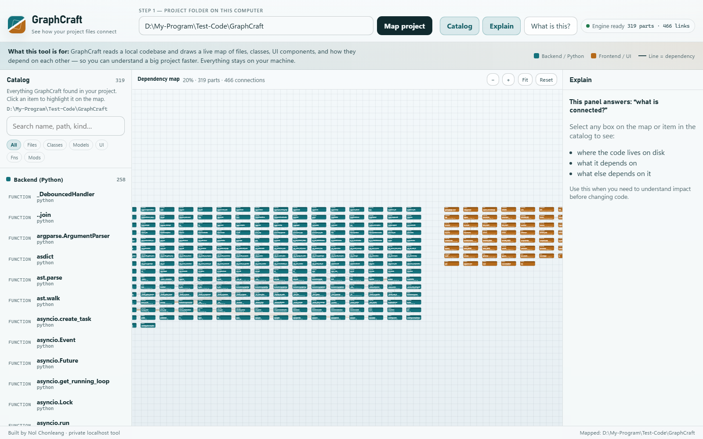

# GraphCraft

**Local codebase dependency mapper** · by [Nol Chhonleang](#author)

GraphCraft reads a project folder on your computer and draws a live map of how files, classes, and UI components connect — so you can understand large codebases faster. Everything stays on localhost; nothing is uploaded.

<p align="center">
  
</p>

<p align="center">
  <em>Catalog · Dependency map · Explain — mapping GraphCraft itself</em>
</p>

---

## Highlights

| | |
|---|---|
| **Offline & private** | Parser + UI run on your machine (`127.0.0.1` only) |
| **Python & TypeScript** | AST for Python; ESM / React patterns for frontend |
| **Live updates** | Rescans when source files change |
| **Interactive map** | Pan, zoom, drag nodes, inspect dependencies |

---

## How it works

```
Your disk  →  Python parser (ast + regex)  →  ws://127.0.0.1:8000
                                                    ↓
Browser UI ←── React + TypeScript canvas ←──────────┘
```

---

## Features

- Parse **Python** — imports, classes, inheritance, Odoo `_inherit` / `_name`, methods
- Parse **TypeScript / React** — ESM imports, components, classes, functions
- **Catalog** of discovered parts with search and kind filters
- **Dependency map** with custom canvas layout (no D3 / Cytoscape)
- **Explain** panel for path, dependents, and dependencies

---

## Requirements

- Python 3.10+
- Node.js 18+
- A modern browser

---

## Setup

### 1. Backend

```bash
cd backend
python -m venv .venv

# Windows PowerShell
.\.venv\Scripts\Activate.ps1

# macOS / Linux
source .venv/bin/activate

pip install -r requirements.txt
python main.py --path ..
```

Optional one-shot JSON (no server):

```bash
python main.py --path .. --once > graph.json
```

### 2. Frontend

```bash
cd frontend
npm install
npm run dev
```

Open **http://127.0.0.1:5174/**

> Port **5174** is used on purpose when **5173** is already taken (common with Docker Desktop).

---

## How to use

1. Start the backend, then open the UI.
2. Paste an absolute project path and click **Map project**.
3. Browse the **Catalog** (left), explore the **Dependency map** (center), use **Explain** (right).
4. Drag to pan, scroll to zoom, click a box to inspect links.

---

## Project layout

```
graphcraft/
├── README.md
├── LICENSE
├── docs/
│   └── screenshot.png
├── backend/
│   ├── requirements.txt
│   ├── main.py
│   └── core/
│       ├── parser.py
│       └── graph.py
└── frontend/
    ├── package.json
    ├── vite.config.ts
    └── src/
        ├── App.tsx
        ├── components/
        └── hooks/
```

---

## Graph JSON shape

```json
{
  "type": "graph",
  "root_path": "/absolute/path",
  "stats": { "node_count": 42, "edge_count": 87 },
  "nodes": [],
  "edges": []
}
```

**Node kinds:** `file` · `class` · `function` · `component` · `module` · `model`  
**Edge kinds:** `import` · `inherit` · `call` · `contains` · `export` · `reference`

---

## Troubleshooting

| Problem | What to try |
|---|---|
| UI cannot connect | Start `backend/main.py`; check port `8000` |
| Empty map | Point the path at a folder with `.py` / `.ts` / `.tsx` / `.js` / `.jsx` |
| Port 5174 busy | Change `server.port` in `frontend/vite.config.ts` |
| Windows venv blocked | `Set-ExecutionPolicy -Scope CurrentUser RemoteSigned` |

---

## Author

**Nol Chhonleang** — creator of GraphCraft.

## License

MIT © 2026 Nol Chhonleang — see [LICENSE](LICENSE).
